<div align="center">
  
  <h1>Anti Phishing Net — One forward. Zero fraud.</h1>
  <p><b>Scam &amp; phishing protection for India, in your own language</b><br><i>Android app • Web checker • Live community scam list • AI + rules engine</i></p>

  <p>
    <a href="https://phishing-net.onrender.com"><b>🌐 Live website</b></a> ·
    <a href="https://phishing-net.onrender.com/dashboard"><b>📊 Live dashboard</b></a> ·
    <b>📱 APK: AntiPhishingNet.apk (in this folder)</b>
  </p>
</div>

---

> ℹ️ **Test data notice:** all scam messages, links, phone numbers and QR codes in this project are fictional samples used only to train and test the scam detector. Nothing here is used to target anyone.

## 📌 Table of Contents

- [Try It](#-try-it)
- [Overview](#-overview)
- [Screenshots](#-screenshots)
- [Tech Stack](#️-tech-stack)
- [Features](#-features)
- [Architecture](#️-architecture)
- [How a Message Is Scored](#-how-a-message-is-scored)
- [AI Model](#-ai-model)
- [Community Scam List](#-community-scam-list)
- [Languages](#️-languages)
- [Privacy — DPDP Act 2023](#-privacy--dpdp-act-2023)
- [Install the App](#-install-the-app)
- [API Routes](#-api-routes)
- [Environment Variables](#️-environment-variables)
- [Local Development](#️-local-development)
- [Deployment — Render](#-deployment--render)
- [Project Structure](#-project-structure)
- [Roadmap](#️-roadmap)
- [Security Notes](#️-security-notes)

---

## 🔓 Try It

> **No sign-up. No download needed.**

Open **https://phishing-net.onrender.com**, paste any suspicious SMS, WhatsApp forward or link, and get a verdict in seconds, with the reasons explained in plain language.

Try this one:

```
Dear SBI customer, your account will be BLOCKED today due to pending KYC.
Update PAN immediately: http://sbi-kyc-update.xyz/verify
```

> 🔴 **Result:** `Phishing · Risk 100/100` — asks for KYC/PAN, creates urgency, threatens to block the account, fake SBI website, cheap `.xyz` domain.

> 🟢 Want protection that works **before** you even open the message? Install the [Android app](#-install-the-app). It watches incoming SMS and app notifications and puts a big red warning on screen when a scam arrives.

> ℹ️ The site runs on a free server. If nobody has used it for a while, the **first** check can take up to a minute while it wakes up.

---

## 🧭 Overview

Every day, millions of Indians get messages like *"your KYC has expired"*, *"your electricity will be cut tonight"*, *"you won ₹25 lakh in KBC"* or calls from a fake *"CBI officer"*. Elders and first-time smartphone users lose savings to them because the messages look real and arrive in their own language.

**Anti Phishing Net** catches these scams and explains *why* they are scams, in the user's own language:

- 📱 **Android app** — with consent, checks every incoming SMS and WhatsApp / Telegram / Gmail notification automatically and shows a full-screen warning over any app.
- 🌐 **Web checker** — for people who don't want an app: paste a message and get the verdict.
- 👥 **Community scam list** — scam websites and phone numbers caught by any user warn everyone else instantly.
- 🤖 **Two brains** — expert rules explain the verdict; a machine-learning model catches new wording the rules have never seen.

```
Product   : Anti Phishing Net
Tagline   : One forward. Zero fraud.
Platforms : Android 8+ · Any web browser
Stack     : Kotlin + Jetpack Compose · Python FastAPI · scikit-learn
Hosting   : Render (Docker) · APK on GitHub Releases
Languages : English, हिंदी, ಕನ್ನಡ, தமிழ், తెలుగు, മലയാളം, मराठी, বাংলা, ગુજરાતી
```

---

## 📸 Screenshots

<div align="center">
  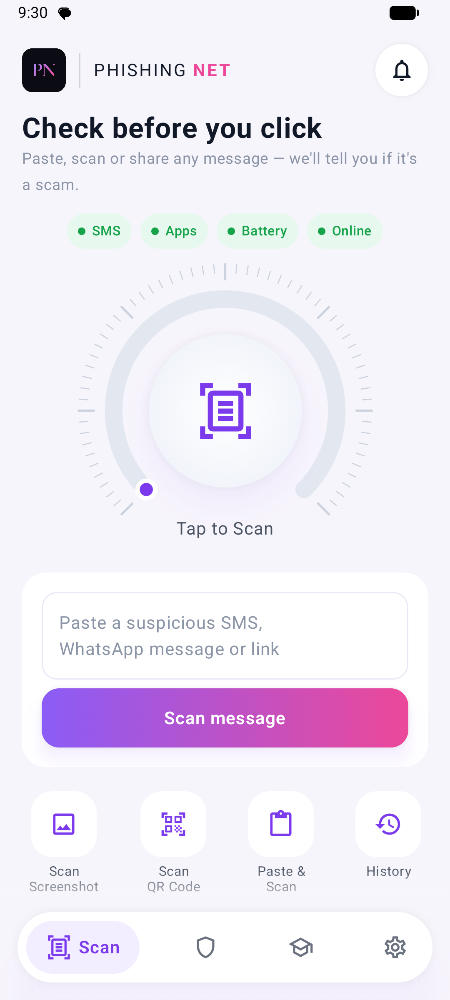
  &nbsp;
  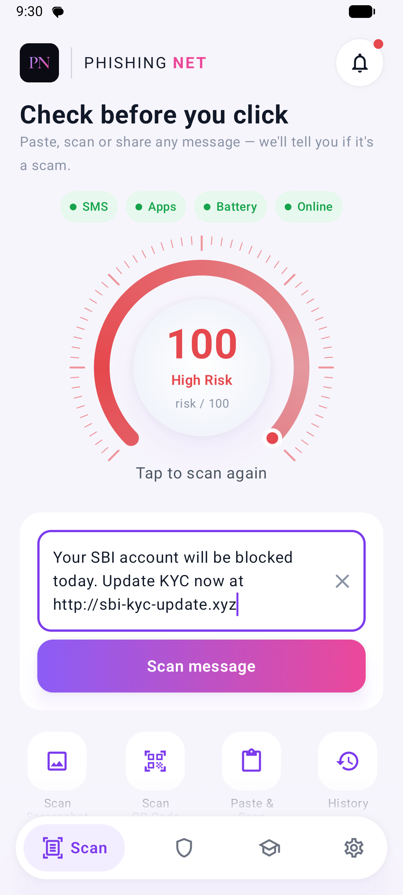
  &nbsp;
  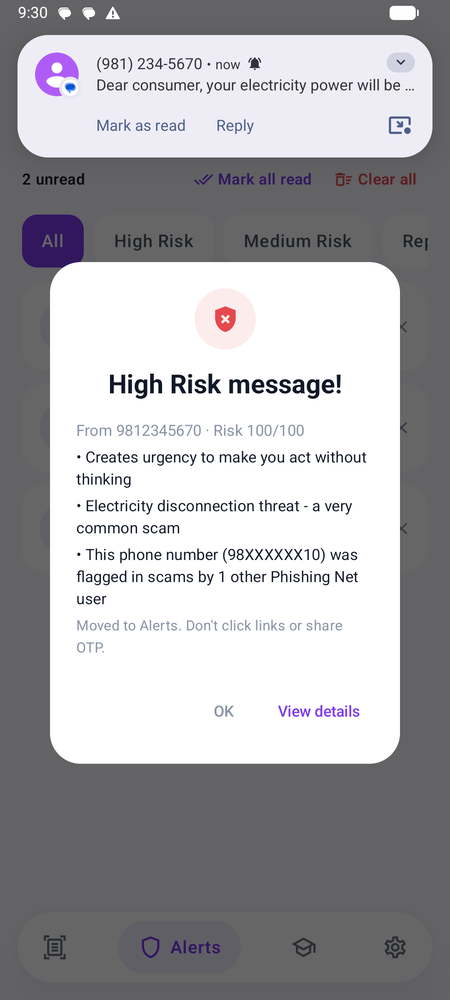
  <br/><br/>
  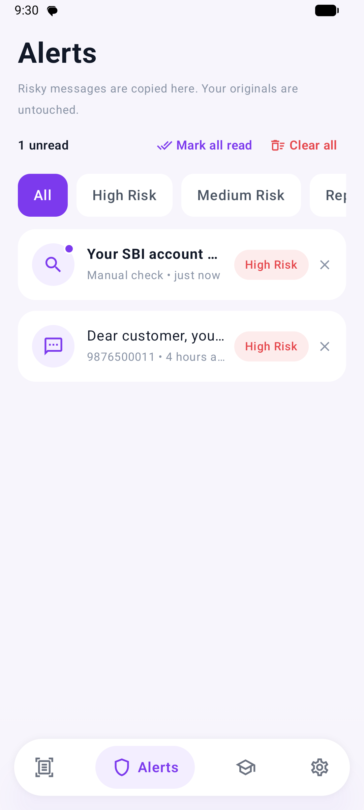
  &nbsp;
  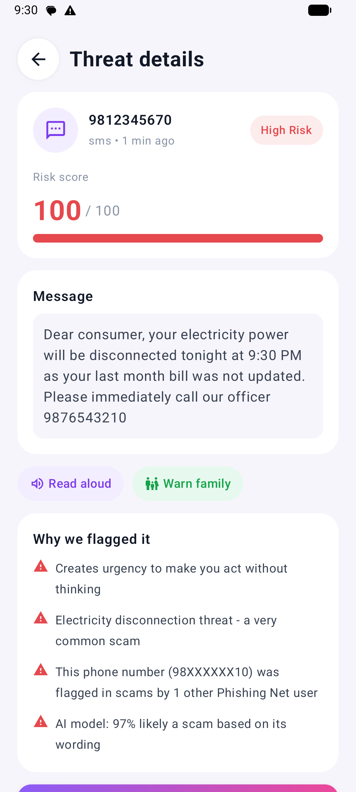
  &nbsp;
  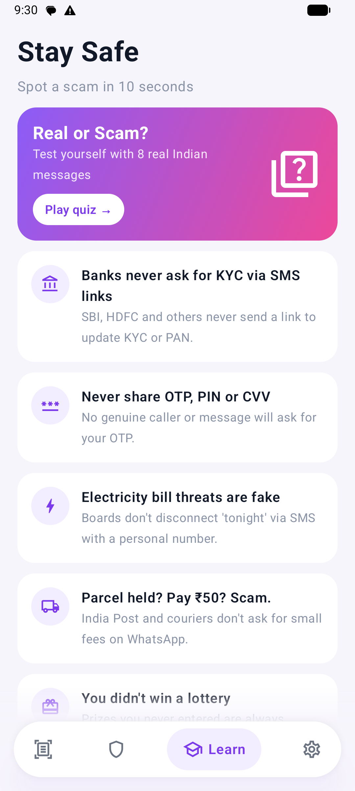
  <br/><br/>
  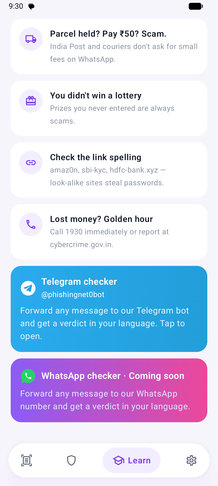
  &nbsp;
  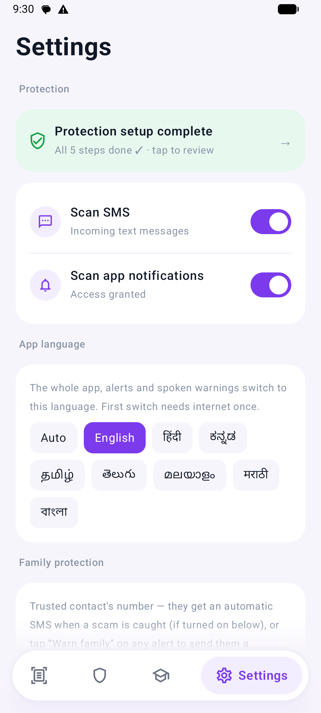
  &nbsp;
  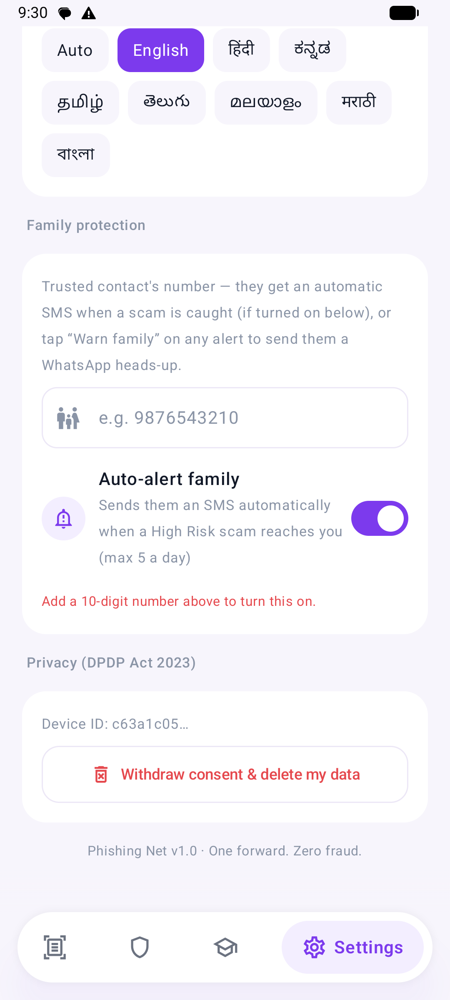
  <br/><br/>
  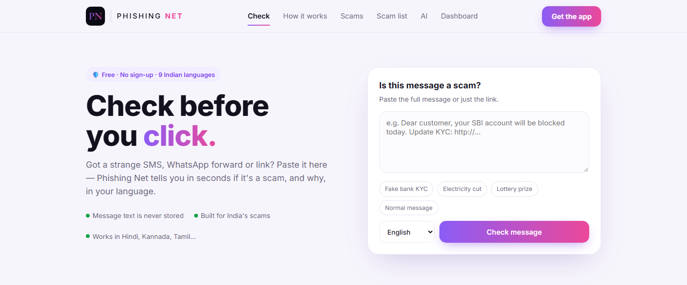
  <br/><br/>
  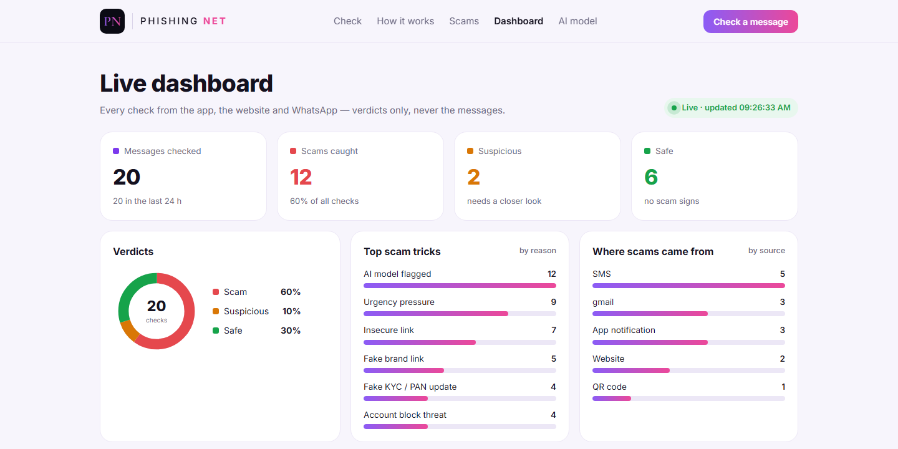
</div>

---

## ⚙️ Tech Stack

| Layer | Technology |
|---|---|
| 📱 **Android app** | Kotlin · Jetpack Compose · Material 3 (Android 8+) |
| 👁️ **On-device vision** | Google ML Kit — text recognition (English + Hindi) · barcode / QR scanning |
| 🌍 **App translation** | Bundled translations (instant, offline) · Google ML Kit on-device translation · Sarvam AI fallback |
| 🖥️ **Server** | Python 3.12 · FastAPI · Uvicorn |
| 🤖 **AI model** | scikit-learn — TF-IDF (words + characters) + Logistic Regression |
| 🗣️ **Indian languages** | Sarvam AI — language detection + translation of verdicts and reasons |
| 🛡️ **Threat intel** | Google Safe Browsing v4 · WHOIS domain age · look-alike brand detection · short-link unwrapping |
| 🗄️ **Scan logs & consent** | Firebase Firestore (hashes and verdicts only — never message text) |
| 🧾 **Shared scam indicators** | Zoho Catalyst Data Store (SHA-256 of reported domains / phone numbers) |
| 💬 **Messaging bots** | Telegram Bot API · WhatsApp Cloud API (Meta) · Twilio |
| 🌐 **Website & dashboard** | Plain HTML + CSS + JS — no framework, hand-made SVG charts |
| 🚀 **Hosting** | Render (Docker) · GitHub Releases for the APK · GitHub Actions + UptimeRobot keep-alive |

---

## ✨ Features

**Three ways to use one engine:**

| | How | Best for |
|---|---|---|
| 📱 **Android app — automatic** | Watches incoming SMS and app notifications, warns before you open them | Everyday protection, elders |
| 🔍 **Manual check** | Paste, share, screenshot or QR — in the app or on the website | One suspicious message |
| ✈️ **Telegram bot** | Forward the message to [@phishingnet0bot](https://t.me/phishingnet0bot), get the verdict as a reply | Anyone on Telegram |
| 💬 **WhatsApp bot** *(coming soon)* | Forward the suspicious message to the bot, get the verdict as a reply | People who live in WhatsApp |

### 📱 Automatic Protection (Android)
- **📩 SMS scanning** — every incoming SMS is checked the moment it arrives
- **🔔 App notification scanning** — WhatsApp, WhatsApp Business, Telegram, Gmail and more (with notification access)
- **🚨 Full-screen scam alert** — a big red warning drawn over whatever app is open, with the message, risk score and reasons
- **🔊 Read aloud** — one tap and the warning is spoken out, in the user's language — made for elders who find small text hard
- **🔔 Heads-up notification** — *"🚨 Phishing message from 98…"* with the risk score and top reason, even when the app is closed
- **🗂️ Soft quarantine** — risky messages are copied to the app's Alerts tab with filters (Phishing / Suspicious / Safe), unread badges and *mark all read*; the original message is never deleted or changed
- **🧾 Threat details** — risk score, the full message, *why we flagged it*, links marked **do NOT open**, and one-tap **Report scam (cybercrime.gov.in)**, **Call 1930**, **Mark safe** and **Remove**
- **📤 Share to check** — share any text, link or image from any app straight to Anti Phishing Net

### 🏠 App Home & Screens
- **👋 Onboarding** — three short screens explaining scams, protection and languages
- **✅ Consent screen** — choose exactly what may be scanned before anything starts
- **🟢 Live status chips** — SMS, Apps, Battery and Server — green when protection is fully on
- **📊 Your protection** — messages checked, threats found, and a **weekly activity chart** (safe vs threats, clean rate)
- **🕘 History** — every manual check with its verdict
- **⚙️ Settings** — scan toggles, app language, family contact, server URL, privacy and data deletion

### 🔍 Manual Checks
- **✍️ Paste a message** — type or paste anything suspicious and tap Scan
- **🖼️ Screenshot scanning** — on-device OCR reads a screenshot of a chat, then checks it
- **📷 QR code scanning** — QR links are checked; **UPI QR codes** are analysed on the phone: a pre-filled amount, *"scan to receive money"* notes and personal-number payees are flagged, because a UPI QR can only **send** money

### 👨‍👩‍👧 Family Safety
- **🆘 Auto-alert family** — add a trusted contact; when a high-risk scam is caught they get an automatic SMS heads-up (links removed, at most 5 a day)
- **💬 Warn family** — one tap on any alert sends them a WhatsApp message about it

### ✈️ Telegram Checker Bot
- **📨 Forward and ask** — forward any suspicious message to [@phishingnet0bot](https://t.me/phishingnet0bot); it replies with the verdict, risk score, reasons and what to do
- **🗣️ Replies in your language** — Hindi, Kannada, Tamil and more
- **🔒 Secure webhook** — `/webhook/telegram` only accepts requests carrying Telegram's secret header

### 💬 WhatsApp Checker Bot *(coming soon)*
- **📨 Forward and ask** — forward any suspicious message to the Anti Phishing Net WhatsApp number; the bot replies with the verdict, risk score, reasons and what to do
- **🗣️ Replies in your language** — if you write in Hindi, Kannada, Tamil and more, the reasons come back in that language
- **👋 Say "hi"** — the bot explains how to use it
- Works with the **Meta WhatsApp Cloud API** (`/webhook/whatsapp`) and **Twilio** (`/webhook/twilio`) — same engine as the app and website

### 📚 Awareness
- **🎓 Learn tab** — the scams going around India right now (fake KYC, electricity cut, digital arrest, lottery / KBC, part-time job, wrong UPI payment, parcel / customs) with how they work and what to do
- **🧠 Scam quiz** — "Scam or safe?" practice rounds
- **📞 Report** — quick buttons to call **1930** (cyber-crime helpline) and open **cybercrime.gov.in**

### 🌐 Website
- **🔎 Web checker** — the same engine as the app, in the browser, with one-tap sample scams to try
- **🗣️ Reply language picker** — reasons in any of 9 languages, plus a **read-aloud** button
- **📤 Share the result** — send the warning to family on WhatsApp (or any app) in one tap
- **👍 "Was this right?"** — feedback that trains the AI model
- **👥 Spotted by the community** — live list of scam websites and numbers, plus *"check a number or website"* lookup
- **📊 Live dashboard** — total checks, scams caught, top tricks, sources, recent scam domains, model accuracy — no personal data
- **📱 APK download** with install help for Play Protect and restricted settings

### 🛡️ Built for Real Phones
- **✅ Setup checklist** — guided steps for SMS, notification access, alerts, battery "Unrestricted" and "display over other apps", with live ✓ status
- **🔓 Restricted-settings helper** — explains and opens *Allow restricted settings* for sideloaded installs
- **🌍 Whole app in your language** — every screen, instantly, offline

---

## 🏗️ Architecture

```
┌──────────────────────────────────────────────────────────────────────┐
│                          ANDROID APP (Kotlin)                         │
│  ┌──────────────┐  ┌──────────────────┐  ┌────────────────────────┐  │
│  │ SMS receiver │  │ Notification     │  │ Share / Paste /        │  │
│  │              │  │ listener (WA,    │  │ Screenshot OCR / QR    │  │
│  │              │  │ Telegram, Gmail) │  │ (ML Kit, on-device)    │  │
│  └──────┬───────┘  └────────┬─────────┘  └───────────┬────────────┘  │
│         └──────────────┬────┴────────────────────────┘               │
│                 On-device pre-filter (only risky-looking messages)    │
│                        │                                              │
│        Full-screen alert · Quarantine · Read aloud · Family SMS       │
└────────────────────────┼──────────────────────────────────────────────┘
                         │ HTTPS  POST /check
┌────────────────────────▼──────────────────────────────────────────────┐
│               PHISHING NET SERVER (FastAPI on Render)                  │
│                                                                        │
│   ┌────────────┐   ┌──────────────────┐   ┌─────────────────────────┐ │
│   │ Language   │──►│ Expert rules     │   │ Link checks             │ │
│   │ detection  │   │ EN + Indian      │   │ short-link unwrap,      │ │
│   │ (Sarvam)   │   │ languages        │   │ look-alike brands, TLD, │ │
│   └────────────┘   └────────┬─────────┘   │ IP / @ tricks, WHOIS    │ │
│                             │             └────────────┬────────────┘ │
│   ┌──────────────────┐      │      ┌──────────────────▼───────────┐  │
│   │ ML model         │──────┼──────│ Google Safe Browsing         │  │
│   │ TF-IDF + LogReg  │      │      │ Community scam list          │  │
│   └──────────────────┘      ▼      └──────────────────────────────┘  │
│                  Weighted risk score 0–100 + reasons                   │
│                             │                                          │
│                  Reasons translated (Sarvam) → verdict                 │
└───────┬─────────────────────┼───────────────────────┬──────────────────┘
        │                     │                       │
┌───────▼────────┐   ┌────────▼──────────┐   ┌────────▼───────────────┐
│ FIREBASE       │   │ ZOHO CATALYST     │   │ WEBSITE + DASHBOARD    │
│ FIRESTORE      │   │ DATA STORE        │   │ (served by the server) │
│ consent, scan  │   │ SHA-256 of known  │   │ web checker, live      │
│ logs (hashes   │   │ scam domains and  │   │ stats, community list  │
│ only)          │   │ phone numbers     │   │                        │
└────────────────┘   └───────────────────┘   └────────────────────────┘
```

> Every external service is **optional**. A missing key is skipped and the rest keeps working. `GET /health` shows which services are live.

---

## 🎯 How a Message Is Scored

Every signal adds points **and** a human-readable reason ([analyzer.py](server/app/analyzer.py)).

```
Message ──► rules (KYC / OTP / urgency / threats / prizes / fees …)
        ──► links (fake brand, cheap domain, short link, new domain, Safe Browsing)
        ──► community list (flagged by other users)
        ──► AI model probability
                    │
                    ▼
         Risk score 0 – 100  +  reasons in the user's language
```

| Score | Verdict | What the user sees |
|---|---|---|
| 0 – 40 | 🟢 **Safe** | Green tick, no alert |
| 41 – 70 | 🟠 **Suspicious** | Warning + reasons, saved to Alerts |
| 71 – 100 | 🔴 **Phishing** | Full-screen red alert, read-aloud, family SMS |

---

## 🤖 AI Model

**See it live:** [phishing-net.onrender.com/model](https://phishing-net.onrender.com/model) shows the scores, confusion matrix, top words the model learned, and a box to test the model alone. The training data is in [server/dataset.csv](server/dataset.csv) (also downloadable from [/api/model/dataset.csv](https://phishing-net.onrender.com/api/model/dataset.csv)).

| Item | Detail |
|---|---|
| **Type** | TF-IDF on words **and** characters → Logistic Regression ([ml.py](server/app/ml.py)) |
| **Training data** | Indian scam and normal-message templates in English and Hindi ([ml_data.py](server/app/ml_data.py)) |
| **Fair test** | Evaluated on **message templates it never saw** (grouped split), not on near-copies |
| **Accuracy** | **89%** on unseen wording |
| **Scams caught (recall)** | **98%** |
| **Learning** | Every *"Was this right?"* answer on the website is stored as feedback and used on the next retrain |

How it is used:
- Model ≥ 80% sure it's a scam → adds up to **+40** points and the reason *"AI model: X% likely a scam"*
- Model very sure it's normal and there are no links → **−10** points (fewer false alarms)

The model is trained during the Docker build, so every deploy ships a fresh model.

---

## 👥 Community Scam List

When a message is marked **Phishing**, its **website and phone number** (never the message text) go on a shared list ([community.py](server/app/community.py)).

- The next person who receives the same site or number gets **"flagged by N other users"** and extra risk points
- Each person is counted once (anonymous hash), so one user can't flood the list
- Phone numbers are shown partly hidden (`98XXXXXX10`)
- Official sites and link shorteners are never listed
- Anyone can look up a number or website on the website

---

## 🗣️ Languages

| Where | How |
|---|---|
| **Scam detection** | Scam words are recognised in English, Hindi, Kannada and Tamil — a scam written in your language is still caught |
| **Verdicts & reasons** | Sarvam AI translates each reason into the message's language (or the language the user picks) |
| **App screens** | All app text is pre-translated into 7 Indian languages and **bundled in the APK** — switching is instant and works offline |
| **Anything new** | Falls back to Google ML Kit on-device translation, then Sarvam |
| **Read aloud** | Android text-to-speech in the user's language, English fallback |
| **Website** | Reply-language picker on the checker; read-aloud in the chosen language |
| **WhatsApp bot** *(coming soon)* | Replies in the language the message was written in |
| **Onboarding & alerts** | Full-screen alerts, notifications and onboarding all follow the app language |

Supported: English · हिंदी · ಕನ್ನಡ · தமிழ் · తెలుగు · മലയാളം · मराठी · বাংলা · ગુજરાતી

---

## 🔒 Privacy — DPDP Act 2023

- ✅ **Consent first** — clear, granular consent screen before anything is scanned; consent is recorded
- 📵 **Message text is never stored** on the server — only the verdict, flags and SHA-256 hashes of links
- 📱 **On-device pre-filter** — only messages with links, numbers or risk words leave the phone
- 👁️ **Read-only** — original SMS and chats are never deleted or changed
- 🗑️ **Right to erasure** — *Settings → Withdraw consent & delete my data* calls `DELETE /user/{id}`
- 🕶️ **Public dashboard is anonymous** — device IDs and hashes are stripped before anything is shown

---

## 📱 Install the App

1. Copy **AntiPhishingNet.apk** (in this folder) to your phone, or use the website's *Download* button
2. Open it and allow *Install unknown apps* if asked
3. Follow the in-app **Finish setup** checklist

> ⚠️ **"App blocked" by Google Play Protect?**
> Play Store → your profile → **Play Protect** → ⚙ → turn off **Scan apps** → install → turn it back on.
> It warns because the app reads SMS (to catch scams) and isn't on the Play Store yet.

> ⚠️ **"App was denied access" for SMS or notifications?**
> Tap Close → phone **Settings → Apps → Anti Phishing Net → ⋮ (top-right) → Allow restricted settings** → allow access again in the app.

---

## 🔌 API Routes

Base URL: `https://phishing-net.onrender.com` · Interactive docs at [`/docs`](https://phishing-net.onrender.com/docs)

### 🔎 Checking
| Endpoint | Method | Description |
|---|---|---|
| `/check` | `POST` | `{text, source?, user_id?, reply_language?}` → `{verdict, risk_score, reasons[], reasons_localized[], urls_found[], language, ml_probability}` |
| `/translate` | `POST` | Translate app UI strings (fallback for the app) |

### 👥 Community & AI
| Endpoint | Method | Description |
|---|---|---|
| `/api/community` | `GET` | Most-reported scam websites and numbers |
| `/api/lookup?q=` | `GET` | Check one website or phone number against the community list |
| `/api/feedback` | `POST` | *"Was this right?"* feedback for the model |
| `/api/model` | `GET` | Model accuracy, recall, training size |
| `/api/model/retrain` | `POST` | Retrain the model in the background |

### 📱 App Sync & Privacy
| Endpoint | Method | Description |
|---|---|---|
| `/consent` | `POST` | Record consent scopes |
| `/quarantine` | `POST` | Sync a quarantined item (verdict + link hashes only) |
| `/report` | `POST` | Report a scam link / number → community list + Catalyst |
| `/user/{id}` | `DELETE` | Withdraw consent and erase all data |

### 💬 Messaging Bots
| Endpoint | Method | Description |
|---|---|---|
| `/webhook/telegram` | `POST` | Telegram bot incoming messages |
| `/api/telegram/setup` | `GET` | Points the Telegram bot at this server |
| `/webhook/whatsapp` | `GET / POST` | Meta WhatsApp Cloud API verification + incoming messages |
| `/webhook/twilio` | `POST` | Twilio WhatsApp webhook |

### 📊 Website
| Endpoint | Method | Description |
|---|---|---|
| `/` | `GET` | Website + web checker |
| `/dashboard` | `GET` | Live public dashboard |
| `/api/stats` | `GET` | Anonymous stats for the dashboard |
| `/download` | `GET` | Redirects to the latest APK |
| `/health` | `GET` | Which services are connected |

---

## 🗝️ Environment Variables

Copy `server/.env.example` to `server/.env`. **Every key is optional** — anything missing is skipped.

```env
# ── Indian languages ──────────────────────────────────────────────
SARVAM_API_KEY=                       # dashboard.sarvam.ai

# ── Threat intel ──────────────────────────────────────────────────
GOOGLE_SAFE_BROWSING_KEY=             # Google Cloud → Safe Browsing API

# ── Firebase Firestore (consent + scan logs) ──────────────────────
FIREBASE_CREDENTIALS=./firebase-service-account.json   # local
FIREBASE_CREDENTIALS_JSON=            # hosting: paste the JSON file's contents instead

# ── Zoho Catalyst Data Store (shared scam indicators) ─────────────
ZOHO_CLIENT_ID=
ZOHO_CLIENT_SECRET=
ZOHO_REFRESH_TOKEN=                   # api-console.zoho.in → Self Client
CATALYST_PROJECT_ID=
CATALYST_TABLE=ScamIndicators         # columns: hash, kind, reported_at

# ── Telegram bot ───────────────────────────────────────────────
TELEGRAM_BOT_TOKEN=           # from @BotFather

# ── WhatsApp bot (Meta Cloud API) ─────────────────────────────────
WHATSAPP_TOKEN=
WHATSAPP_PHONE_NUMBER_ID=
WHATSAPP_VERIFY_TOKEN=phishingnet-verify

# ── WhatsApp bot (Twilio) ─────────────────────────────────────────
TWILIO_ACCOUNT_SID=
TWILIO_AUTH_TOKEN=

# ── Hosting ───────────────────────────────────────────────────────
APK_URL=                              # /download redirects here (GitHub Release asset)
CHECK_NETWORK=1                       # 0 = skip WHOIS / Safe Browsing (offline tests)
```

> ⚠️ `.env`, `render.env` and every `*service-account*.json` are git-ignored. Never commit them.

---

## 🖥️ Local Development

### Server

```bash
cd server
python -m venv .venv
.venv/Scripts/pip install -r requirements.txt      # Windows  (Linux/macOS: .venv/bin/pip)
cp .env.example .env                               # fill in the keys you have
.venv/Scripts/python -m uvicorn app.main:app --reload --port 8000
```

- Website → **http://localhost:8000**
- Dashboard → **http://localhost:8000/dashboard**
- API docs → **http://localhost:8000/docs**

Quick test:

```bash
curl -X POST http://localhost:8000/check -H "Content-Type: application/json" \
     -d '{"text":"Your SBI KYC expired, update now: bit.ly/xyz"}'
```

Run the tests:

```bash
.venv/Scripts/python -m pytest -v
```

### Android app

```powershell
.\build-apk.ps1        # builds android/ → PhishingNet.apk
adb install -r PhishingNet.apk
```

The app talks to `https://phishing-net.onrender.com` by default. To use a local server, change **Settings → Server URL** in the app (emulator: `http://10.0.2.2:8000`).

Regenerate the bundled app translations after changing UI text:

```bash
cd server && .venv/Scripts/python -m tests.make_app_translations
```

---

## 🚀 Deployment — Render

1. **New Web Service** → connect this repo → **Root directory** `server` → **Runtime** Docker → **Free** plan
2. **Environment** → *Add from .env* → paste your keys (use `FIREBASE_CREDENTIALS_JSON` with the file's contents)
3. Deploy — the Dockerfile installs dependencies, **trains the ML model**, and starts Uvicorn on `$PORT`
4. Upload the APK to a **GitHub Release** and set `APK_URL` to its download link

### ✅ Keep-alive

Render's free plan sleeps after 15 minutes without visitors. Two pingers keep it awake:

- **GitHub Actions** — [`.github/workflows/keep-awake.yml`](.github/workflows/keep-awake.yml) calls `/health` every 10 minutes
- **UptimeRobot** — checks `/health` every 5 minutes and emails if the site goes down

---

## 📁 Project Structure

```
.
├── android/
│   └── app/src/main/
│       ├── java/com/phishingnet/app/
│       │   ├── MainActivity.kt        📱  Screens: Scan, Alerts, Learn, Settings, consent, tab bar
│       │   ├── Scanner.kt             🔍  Pre-filter + server check + notifications
│       │   ├── Receivers.kt           📩  SMS receiver + notification listener
│       │   ├── AlertOverlay.kt        🚨  Full-screen scam alert over any app
│       │   ├── ImageScan.kt           🖼️  Screenshot OCR + QR / UPI analysis (ML Kit)
│       │   ├── FamilyAlert.kt         👨‍👩‍👧  Family SMS / WhatsApp warnings
│       │   ├── Setup.kt               ✅  Permission checklist + restricted-settings helper
│       │   ├── I18n.kt                🌍  Whole-app translation (bundled + on-device + Sarvam)
│       │   ├── Extras.kt              🎓  Learn content, quiz, charts, read-aloud
│       │   └── Repo.kt                🗄️  Local storage + server API client
│       ├── assets/i18n/               🗣️  Pre-translated UI text (hi, kn, ta, te, ml, mr, bn)
│       └── AndroidManifest.xml
├── server/
│   ├── app/
│   │   ├── main.py                    🚪  FastAPI routes
│   │   ├── analyzer.py                🎯  Rules engine + risk score + reasons
│   │   ├── url_checks.py              🔗  Link checks: brands, TLDs, short links, WHOIS, Safe Browsing
│   │   ├── ml.py                      🤖  Model training, evaluation, prediction, feedback
│   │   ├── ml_data.py                 📚  Training templates (scam + normal)
│   │   ├── community.py               👥  Community scam list
│   │   ├── sarvam.py                  🗣️  Sarvam AI language detection + translation
│   │   ├── storage.py                 🗄️  Firestore + Zoho Catalyst
│   │   ├── whatsapp.py                💬  WhatsApp bot message parsing + replies
│   │   ├── config.py                  ⚙️  Environment variables
│   │   └── static/                    🌐  Website, dashboard, logo
│   ├── tests/                         🧪  Tests + helper scripts
│   ├── Dockerfile                     🐳  Render build (trains the model)
│   ├── requirements.txt
│   └── .env.example                   🗝️  Key template
├── test-images/                       🖼️  Sample scam screenshots + QR codes
├── .github/workflows/keep-awake.yml   ⏰  Keep-alive ping
├── build-apk.ps1                      🔨  Build the APK
└── run-server.ps1                     ▶️  Run the server locally
```

---

## 🗺️ Roadmap

- [ ] 💬 WhatsApp bot on a dedicated business number — forward any message, get a verdict back
- [ ] 🏪 Play Store release (removes the Play Protect and restricted-settings steps)
- [ ] 🔊 Sarvam text-to-speech voices for more natural read-aloud
- [ ] 📍 *"New scam in your area"* alerts from the community list
- [ ] 📴 Fully offline on-device model (TFLite)
- [ ] 🚓 Direct reporting to the 1930 / NCRP portal
- [ ] 🍎 iOS app with a Message Filter extension

---

## 🛡️ Security Notes

> ⛔ **Secrets stay out of git**: `server/.env`, `server/render.env` and every service-account JSON are in `.gitignore`. On Render, keys live only in the service's environment settings.

> 🔒 **No message text on the server**: `/check` returns a verdict but only hashes, flags and the verdict are logged. The public dashboard strips device IDs and link hashes before sending anything.

> 🧾 **Hashes, not data**: shared scam indicators in Zoho Catalyst are SHA-256 hashes of domains and phone numbers.

> 👁️ **Read-only on the phone**: the app never deletes, edits or sends the user's messages. Family SMS alerts are sent only when the user turns them on, with links removed.

> 🧯 **Fails open, never crashes**: if any outside service is down or a key is missing, that check is skipped and the rest of the engine still gives a verdict.

---

<div align="center">
  <i>🛡️ Anti Phishing Net — One forward. Zero fraud.</i><br/>
  <i>Lost money to a scam? Call <b>1930</b> or report at <a href="https://cybercrime.gov.in">cybercrime.gov.in</a></i>
</div>
